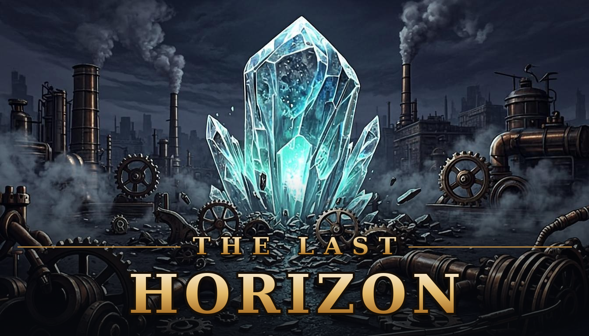

# ⚙ Последний горизонт



Паропанк tower defense в браузере, в изометрии. Новый живой минерал убил восемь из десяти людей и изменил зверей, лес и машины. Заражённые идут по тракту к лагерю беженцев — ставьте башни, сливайте их в уникальные и продержитесь **20 волн** до Колосса Разлома. Иногда на связь выходит загадочный ИИ.


## Что внутри

- **Пошаговое меню на весь экран.** Главная с арт-логотипом → выбор карты → выбор героя; между шагами анимированные переходы, живой изометрический мир виден фоном.
- **6 карт на выбор.** У каждой — фиксированная тропа и особенность: Старая мельница (длинная петля), Каменный мост (извилисто, мест мало), Заброшенные шахты (максимум мест), Ледяной перевал (крипы быстрее на 10%), Пепельная долина (+6 универсальных врагов в волне). В меню — живой предпросмотр тропы каждой карты.
- **Второй выход.** На Пепельной долине с 16-й волны открывается второй портал Разлома: тропа подсвечивается за волну до открытия, дальше крипы делятся между тропами поровну.
- **20 волн на каждой карте.** Волны 9 и 19 — денежные (золото ×3), 10 и 20 — боссы (Колосс Разлома). С 11-й волны в ротации появляется универсальная броня. Скорость крипов растёт на 1% за волну (максимум +25%).
- **15 башен и 12 рецептов слияния.** У каждой башни своя механика: замедление, заморозка, цепная молния, болт насквозь, удар по площади, пар, аура, разгон, фокус луча. На 5-м уровне открывается способность.
- **Арсенал с роллом.** В продаже 5 случайных башен из 15, ролл за 10 золота меняет весь пул.
- **Постройка перетаскиванием.** Башню тащат из арсенала на клетку, а пока она выбрана, на поле виден радиус атаки.
- **9 видов врагов.** По два стимпанк-вида на каждый тип брони и босс Колосс Разлома. Против каждой брони эффективнее свой тип атаки.
- **4 аватара.** Охотница (метка цели), Воевода (разгон башен), Архимаг (метеор по площади), Инженер (ускорение башни, выгодная продажа). Аватар ходит по карте, растёт в уровнях и атакует сам.
- **Пиксельная графика в ретро-стиле** и HUD поверх полноэкранного поля с анимациями.
- **Кооп на двоих по ссылке.** Нужен сервер-посредник `mini-services/mp-service`; HP волн при двух игроках ×1.85.
- **Для тестов:** пауза (P), бесконечное золото и шуточный скин башен.

## Запуск

Нужен Node.js 20+.

```bash
npm install
npx next dev -p 3000
```

После запуска открыть http://localhost:3000.

`npm run dev` тоже работает, но только в Linux и macOS: в скрипте используется `tee`.

## Тесты движка

```bash
npx tsx scripts/test-maps.ts       # карты, фичи, 20 волн, победа на 20-й
npx tsx scripts/test-second-exit.ts # второй выход: генерация тропы, спавн поровну, снапшоты
npx tsx scripts/test-towers.ts     # башни, матрица урона, слияния
npx tsx scripts/test-merge-ids.ts  # защита от краша при повторных слияниях
npx tsx scripts/test-map.ts        # сетка, стройка, синхронизация тропы по зерну
npx tsx scripts/test-coop.ts       # кооп-множитель, снапшоты, команды гостя
npx tsx scripts/test-avatars.ts    # способности и уровни аватаров
npx tsx scripts/test-shop-pause.ts # арсенал, ролл, пауза
```

Скрипт `scripts/pick-maps.ts` — подбор фиксированных зёрен для новых карт по длине и извилистости тропы.

## Устройство

| Где | Что |
|-----|-----|
| `src/game/engine.ts` | Движок: волны, башни, слияния, снаряды, кооп-снапшоты |
| `src/game/config.ts` | Весь баланс: башни, рецепты, броня, волны, враги, реестр карт |
| `src/game/map.ts` | Сетка и генерация троп по зерну; второй выход — маршрутом Дейкстрой мимо первой тропы |
| `src/game/pixel.ts` | Пиксельные спрайты, фон, декор, башни |
| `src/game/render.ts` | Отрисовка кадра |
| `src/components/td/` | Интерфейс: HUD, панели, оболочка игры |
| `public/logo-the-last-horizon.png` | Логотип главного экрана |
| `upload/` | Дизайн-документы (GDD) |
