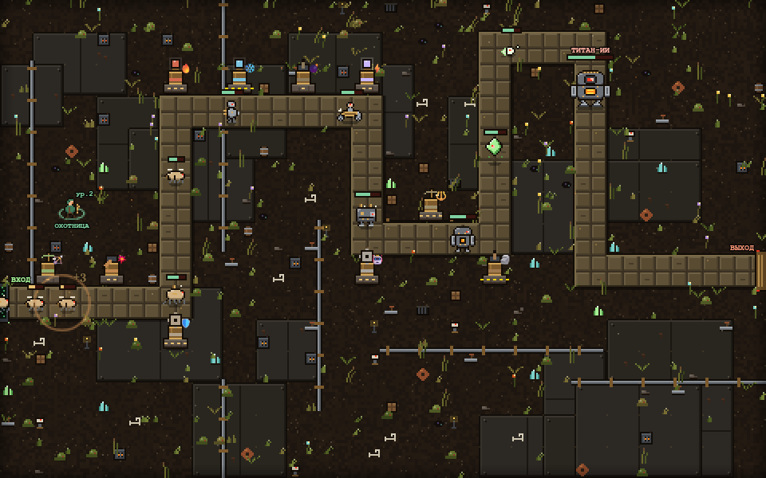

# ⚙ Железный Разлом

Пиксельный стимпанк tower defense в браузере. Новый минерал пробудил древний ИИ, и его машины маршируют по Пограничному тракту. Ставьте башни, сливайте их в уникальные и продержитесь 10 волн до Титана-ИИ.



## Что внутри

- **15 башен и 12 рецептов слияния.** У каждой башни своя механика: замедление, заморозка, цепная молния, болт насквозь, удар по площади, пар, аура, разгон, фокус луча. На 5-м уровне открывается способность.
- **Арсенал с роллом.** В продаже 5 случайных башен из 15, ролл за 10 золота меняет весь пул.
- **Случайная карта.** Тропа генерируется заново в каждой игре, поле разбито на клетки.
- **Постройка перетаскиванием.** Башню тащат из арсенала на клетку, а пока она выбрана, на поле виден радиус атаки.
- **9 видов врагов.** По два стимпанк-вида на каждый тип брони и босс Титан-ИИ. Против каждой брони эффективнее свой тип атаки.
- **Охотница.** Герой ходит по карте, растёт в уровнях и ставит «Метку добычи».
- **Пиксельная графика в ретро-стиле** и HUD поверх полноэкранного поля с анимациями.
- **Кооп на двоих по ссылке.** Нужен сервер-посредник `mini-services/mp-service`.
- **Для тестов:** пауза (P), бесконечное золото и шуточный скин башен.

## Запуск

Нужен Node.js 20+.

```bash
npm install
npx next dev -p 3000
```

После запуска открыть http://localhost:3000.

`npm run dev` тоже работает, но только в Linux и macOS: в скрипте используется `tee`.

## Тесты движка

```bash
npx tsx scripts/test-towers.ts
npx tsx scripts/test-map.ts
npx tsx scripts/test-shop-pause.ts
```

## Устройство

| Где | Что |
|-----|-----|
| `src/game/engine.ts` | Движок: волны, башни, слияния, снаряды, кооп-снапшоты |
| `src/game/config.ts` | Весь баланс: башни, рецепты, броня, волны, враги |
| `src/game/map.ts` | Сетка и генерация тропы по зерну |
| `src/game/pixel.ts` | Пиксельные спрайты, фон, декор, башни |
| `src/game/render.ts` | Отрисовка кадра |
| `src/components/td/` | Интерфейс: HUD, панели, оболочка игры |
| `upload/` | Дизайн-документы (GDD) |
