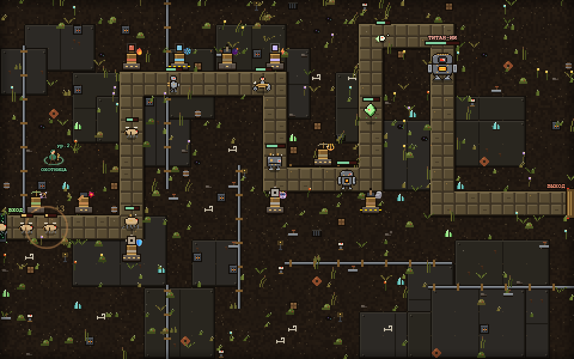

# ⚙ Последний горизонт


Паропанк tower defense в браузере, в изометрии. Новый живой минерал убил восемь из десяти людей и изменил зверей, лес и машины. Заражённые идут по тракту к лагерю беженцев — ставьте башни, сливайте их в уникальные и продержитесь **30 волн**. На 10-й волне придёт Колосс Разлома, на 20-й — Матка, а на 30-й лагерь попытается уничтожить четырёхфазное Сердце Разлома. Иногда на связь выходит загадочный ИИ.



## Что внутри

- **Пошаговое меню на весь экран.** Главная с арт-логотипом → выбор карты → сложность → выбор героя; между шагами анимированные переходы, живой изометрический мир виден фоном. Предпросмотр каждой карты — её настоящий запечённый мир с маршрутом и стрелками хода.
- **Игра на весь экран.** Поле 1280×720 (16:9, сетка 32×18) заполняет экран целиком; HUD и арсенал — полупрозрачные оверлеи поверх.
- **6 карт на выбор.** У каждой — фиксированная тропа и особенность: Старая мельница (длинная петля), Каменный мост (извилисто, мест мало), Заброшенные шахты (максимум мест), Ледяной перевал (крипы быстрее на 10%), Пепельная долина (+3 универсальных врага в волне). В меню — живой предпросмотр тропы каждой карты.
- **Второй выход.** На Пепельной долине с 16-й волны открывается второй портал Разлома: тропа подсвечивается за волну до открытия, дальше крипы делятся между тропами поровну.
- **30 волн на каждой карте.** Волны 9, 19 и 29 — денежные (золото ×3); 10, 20 и 30 — боссы. С 11-й волны в ротации появляется универсальная броня, а волны 21–28 смешаны из двух типов. Скорость крипов растёт на 1% за волну (максимум +25%).
- **Главное здание вместо жизней.** У лагеря 200 HP (Новобранец — 280, Кошмар — 150). Обычный прорыв снимает 10 HP, прорыв босса — 100. HP-бар виден в HUD и над генератором лагеря; при нуле — поражение.
- **Три сложности.** Новобранец (HP врагов ×0.75, 200 золота, броня видна на две волны вперёд), Ветеран (базовый баланс, 150 золота) и Кошмар (HP ×1.4 с разгоном к 10-й волне, 120 золота, смешанные волны с 11-й и вторая способность у каждого босса). Сложность выбирается в меню и сохраняется при повторе.
- **15 башен и 12 рецептов слияния.** У каждой башни своя механика: замедление, заморозка, цепная молния, болт насквозь, удар по площади, пар, аура, разгон, фокус луча. На 5-м уровне открывается способность.
- **Арсенал с роллом.** В продаже 5 случайных башен из 15, ролл за 10 золота меняет весь пул.
- **Постройка перетаскиванием.** Башню тащат из арсенала на клетку, а пока она выбрана, на поле виден радиус атаки.
- **9 видов врагов и 3 босса.** По два стимпанк-вида на каждый тип брони; Колосс Разлома (10), Матка Разлома с призывом выводка (20) и Сердце Разлома с четырьмя фазами (30). Против каждой брони эффективнее свой тип атаки.
- **4 аватара.** Охотница (метка цели), Воевода (разгон башен), Архимаг (метеор по площади), Инженер (ускорение башни, выгодная продажа). Аватар ходит по карте, растёт в уровнях и атакует сам.
- **Пиксельная графика в ретро-стиле** и HUD поверх полноэкранного поля с анимациями.
- **Экран результата.** Победа или поражение, статистика миссии, «Повторить» с той же сложностью и «Следующая миссия».
- **Кооп на двоих по ссылке.** Нужен сервер-посредник `mini-services/mp-service`; HP волн при двух игроках ×1.85.
- **Для тестов:** пауза (P), бесконечное золото и шуточный скин башен.

## Запуск

Нужен Node.js 20+.

```bash
npm install
npx next dev -p 3000
```

После запуска открыть http://localhost:3000.

`npm run dev` тоже работает, но только в Linux и macOS: в скрипте используется `tee`.

## Тесты движка

```bash
npx tsx scripts/test-formulas.ts   # золотые тесты формул: HP, золото, матрица урона
npx tsx scripts/test-sim.ts        # headless-симулятор: политики, отчёт, детерминизм
npx tsx scripts/test-maps.ts       # карты, фичи, 30 волн, сложности, победа на 30-й
npx tsx scripts/test-second-exit.ts # второй выход: генерация тропы, спавн поровну, снапшоты
npx tsx scripts/test-towers.ts     # башни, матрица урона, слияния
npx tsx scripts/test-bosses.ts     # три босса, фазы, призывы, способности Кошмара
npx tsx scripts/test-merge-ids.ts  # защита от краша при повторных слияниях
npx tsx scripts/test-map.ts        # сетка, стройка, синхронизация тропы по зерну
npx tsx scripts/test-coop.ts       # кооп-множитель, снапшоты, команды гостя
npx tsx scripts/test-avatars.ts    # способности и уровни аватаров
npx tsx scripts/test-shop-pause.ts # арсенал, ролл, пауза
```

Скрипт `scripts/pick-maps.ts` — подбор фиксированных зёрен для новых карт по длине и извилистости тропы.

## Симулятор баланса

Полная миссия без браузера и рендера — за доли секунды:

```bash
npx tsx scripts/sim.ts --policy scripted --seed 20261029
npx tsx scripts/sim.ts --policy none --seed 7
npx tsx scripts/sim.ts --difficulty nightmare --seed 20261029
npx tsx scripts/sim.ts --shop pool --json reports/run.json --csv reports/run.csv

# Сводка win-rate и длины миссии по картам/сложностям
npx tsx scripts/balance.ts --seeds 6
npx tsx scripts/balance.ts --maps tract --difficulty nightmare --seeds 12
```

Политики `none` / `random` / `scripted`, три сложности, отчёт по волнам (золото,
утечки и урон по зданию, урон, DPS, постройки, слияния, фазы боссов), event-log и
побайтно воспроизводимый JSON при одном seed. Подробности — `docs/simulator.md`.

## Устройство

| Где | Что |
|-----|-----|
| `src/game/engine.ts` | Движок: волны, башни, слияния, снаряды, кооп-снапшоты, event-log |
| `src/game/config.ts` | Точка входа баланса — re-export из `src/game/data/*` |
| `src/game/data/` | Источник правды: башни, слияния, броня, волны, враги, карты, экономика, сложности |
| `src/game/sim.ts` | Headless-симулятор и политики (без DOM) |
| `src/game/map.ts` | Сетка и генерация троп «меандром» по зерну; второй выход — маршрутом Дейкстрой мимо первой тропы |
| `src/game/pixel.ts` | Пиксельные спрайты, фон, декор, башни |
| `src/game/render.ts` | Отрисовка кадра |
| `src/components/td/` | Интерфейс: HUD, панели, оболочка игры |
| `public/logo-the-last-horizon.png` | Логотип главного экрана |
| `upload/` | Дизайн-документы (GDD) |
