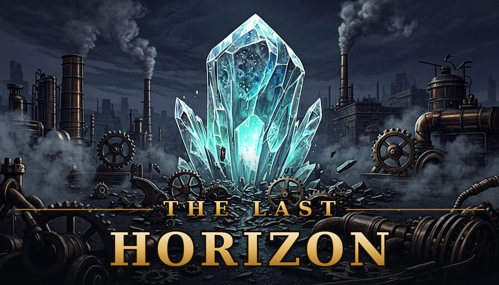
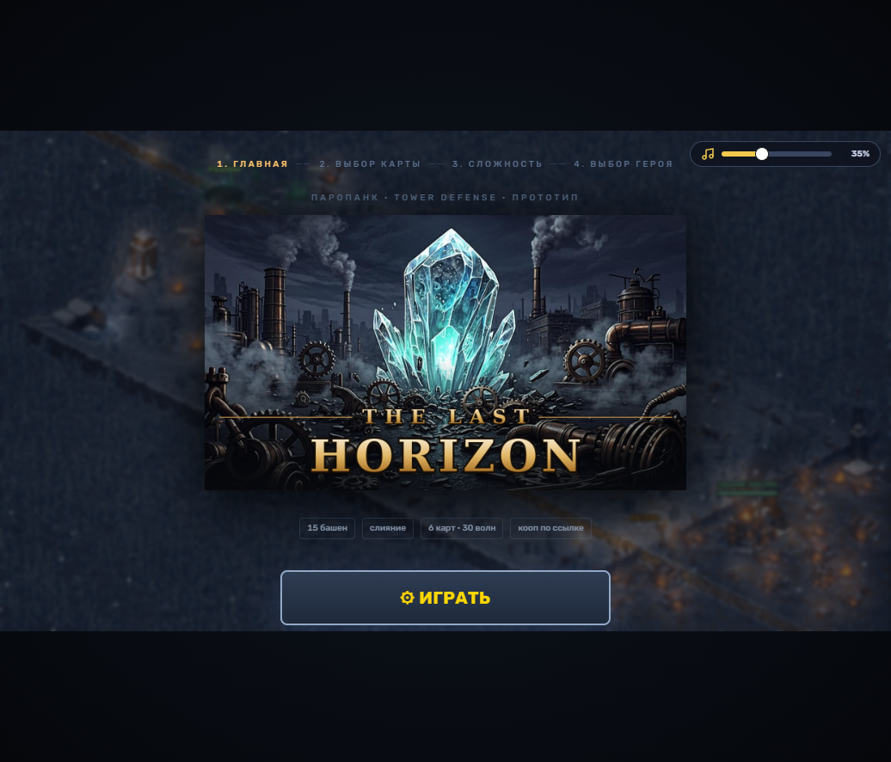
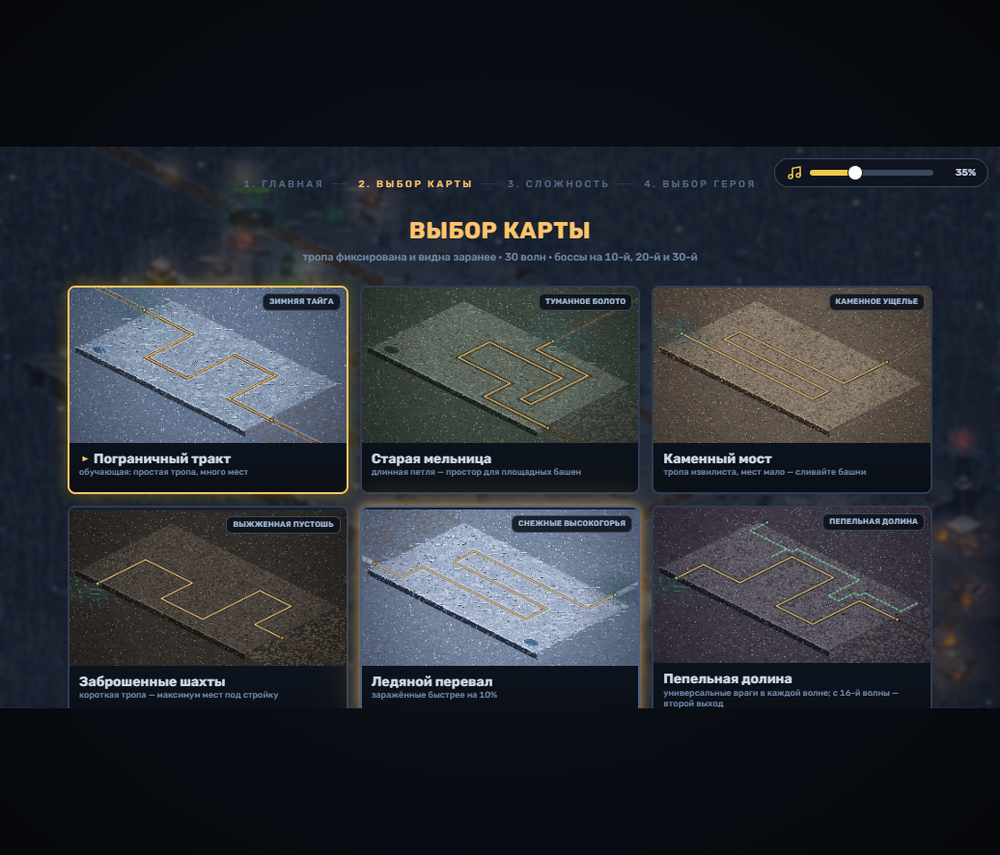
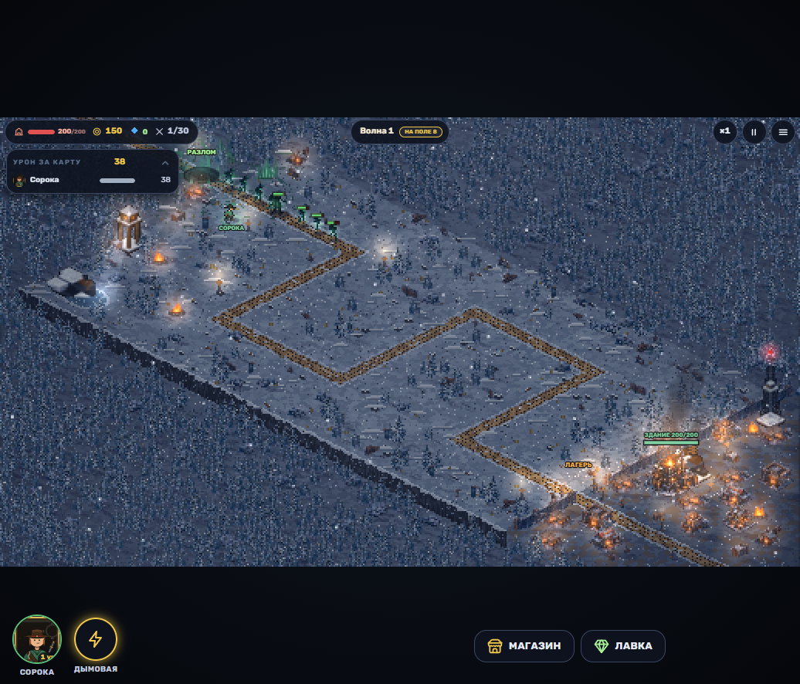
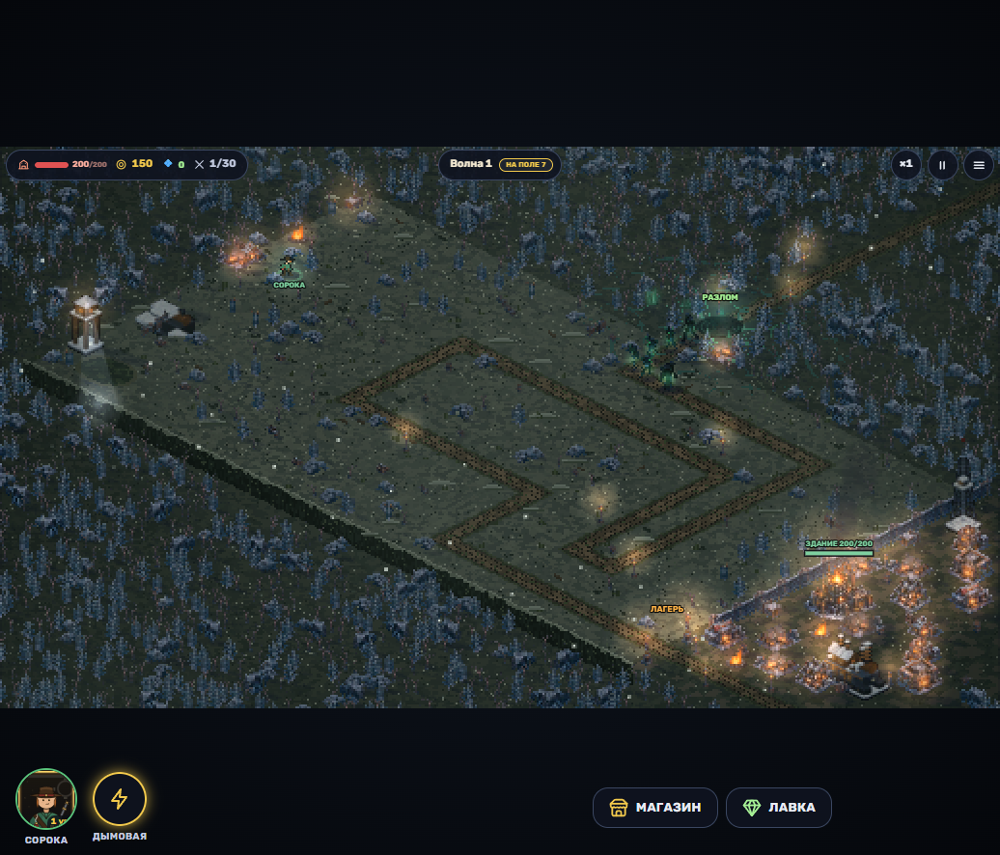
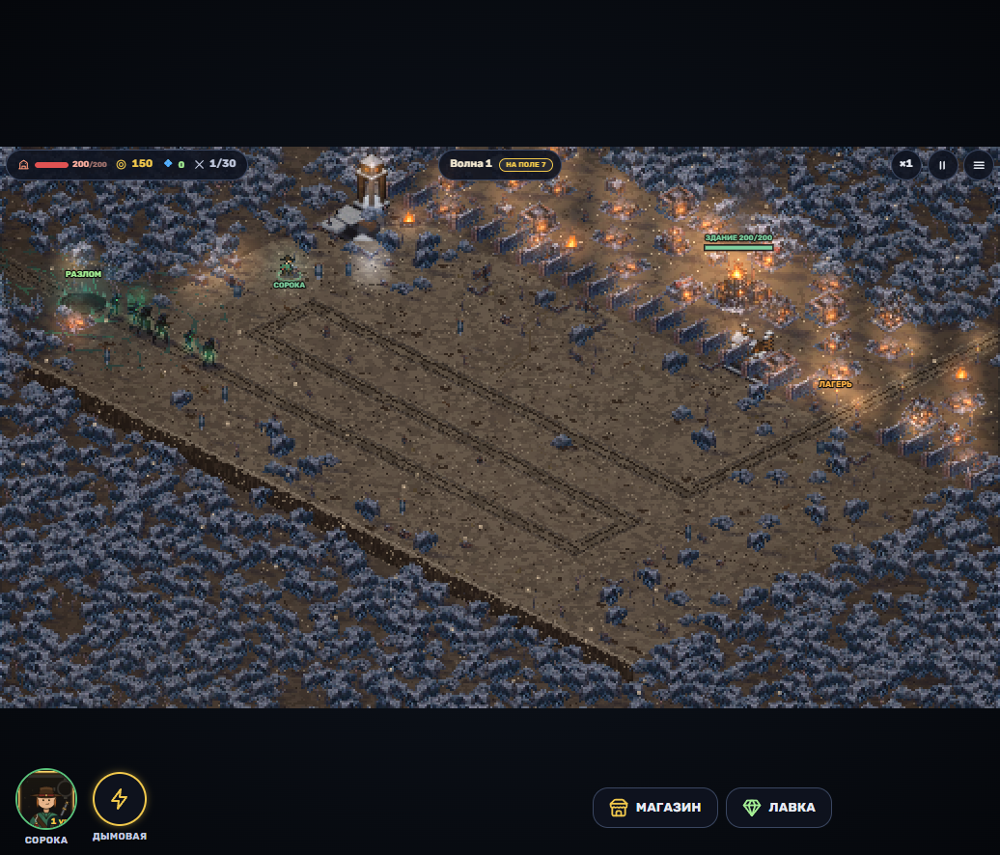
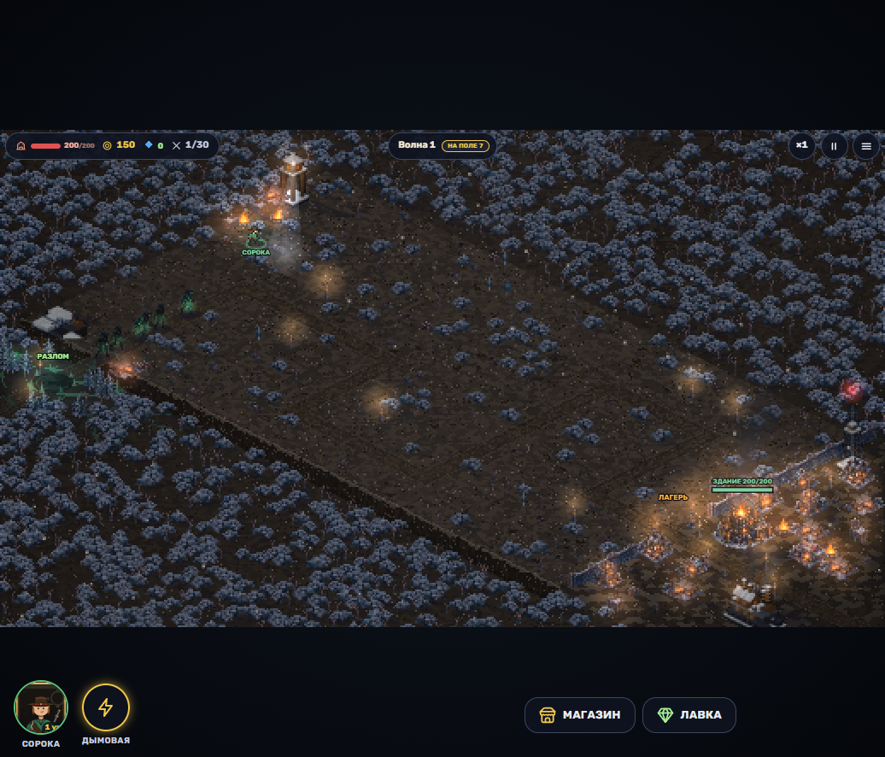
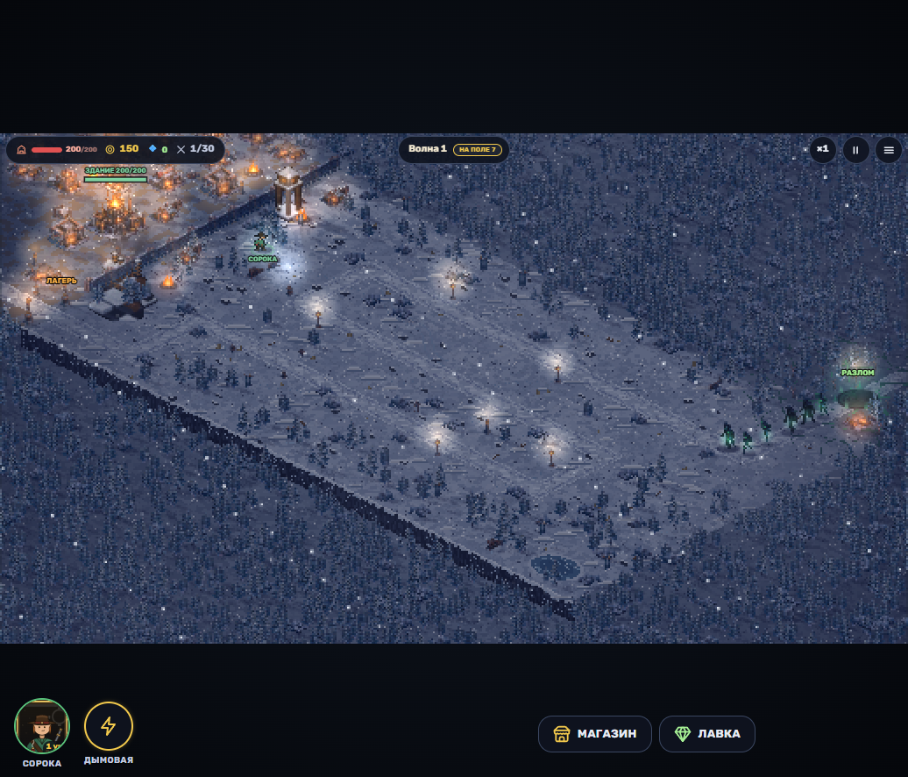
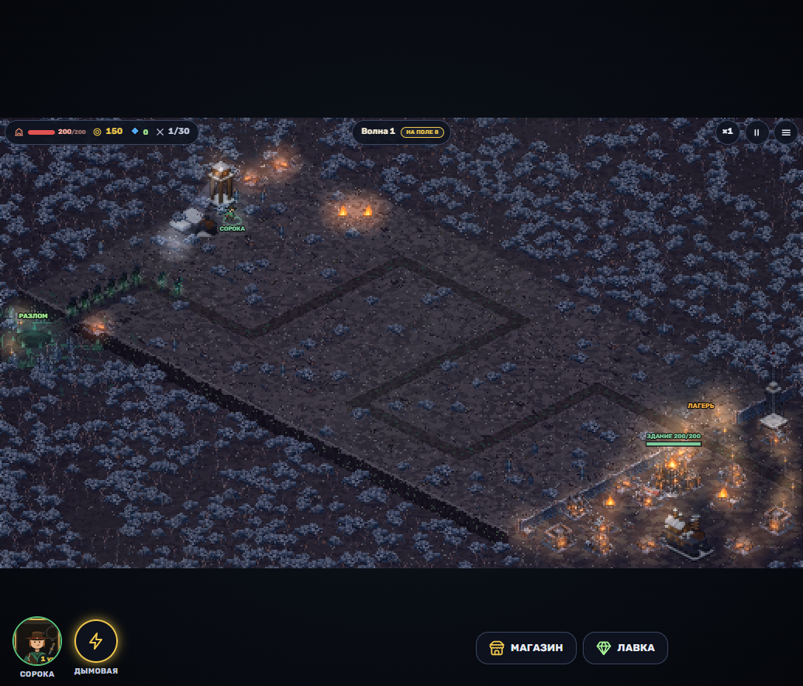

# ⚙ Последний горизонт



Паропанк tower defense в браузере, в изометрии. Новый живой минерал убил восемь из десяти людей и изменил зверей, лес и машины. Заражённые идут по тракту к лагерю беженцев — ставьте башни, сливайте их в уникальные и продержитесь **30 волн**. На 10-й волне придёт Колосс Разлома, на 20-й — Матка, а на 30-й лагерь попытается уничтожить четырёхфазное Сердце Разлома. Иногда на связь выходит загадочный ИИ.



## Что внутри

- **Хаб-меню «командный пункт» на весь экран.** Один экран-терминал лагеря вместо степпера, на чертёжном фоне (техническая сетка, шестерни, схема трактов и живой минерал в карантинной границе): сектора КАМПАНИЯ (карта кампании с узлами), СОБЫТИЯ (сундук за вход и задачи дня), ПРОФИЛЬ (статистика и коллекция деталей) и НАСТРОЙКИ; над секторами — строка-сводка ИИ, внизу мини-профиль и кнопка «+» — кооп по ссылке. Выбор миссии — модалкой на узле карты: живой предпросмотр (настоящий запечённый мир с маршрутом, порталом, лагерем и бейджем биома) + сложность + герой + «В бой» / «Вдвоём» в одном диалоге. Хаб сидит на чистом чертеже, секторам дана тёмная подложка — их плотный текст не спорит со штампом и выносками.
- **ПРОФИЛЬ как игровой экран** (по референсам BTD6 Insta-Monkeys, альманаха PvZ и Hero Room Kingdom Rush, `docs/profile-survey/`): личная карточка командира (портрет героя в латунной рамке, роль, ключевые статы), лесенка кампании из живых мини-превью карт (заблокированные — grayscale с замком, у побеждённых ★), коллекция деталей — сетка карточек башен: живой pixel-спрайт той же башни, что на поле, три стата с цветными мини-барами (урон/скорострельность/дальность), бейдж суммы единиц в слоте, собранная башня — латунная рамка с меткой «СОБРАНО», несобранная — приглушена; общий прогресс «СОБРАНО X%» с баром над сеткой.
- **Игра на весь экран.** Поле 1280×720 (16:9, сетка 32×18) заполняет экран целиком; HUD и арсенал — полупрозрачные оверлеи поверх.
- **6 карт — 6 биомов.** У каждой карты свой облик: зимняя тайга, туманное болото, каменное ущелье, выжженная пустошь, снежные высокогорья и пепельная долина. Свои палитра земли и леса, стиль тропы, озёра, утёс под передним краем, пропсы, частицы в воздухе и цвет сумрака. Тропа входит и выходит с разных кромок поля — портал Разлома стоит за кромкой входа, зимний лагерь беженцев за кромкой выхода. Подробно — [ниже](#шесть-карт--шесть-биомов).
- **Второй выход.** На Пепельной долине с 16-й волны открывается второй портал Разлома: тропа подсвечивается за волну до открытия, дальше крипы делятся между тропами поровну.
- **30 волн на каждой карте.** Волны 9, 19 и 29 — денежные (золото ×3); 10, 20 и 30 — боссы. С 11-й волны в ротации появляется универсальная броня, а волны 21–28 смешаны из двух типов. Скорость крипов растёт на 1% за волну (максимум +25%).
- **Главное здание вместо жизней.** У лагеря 200 HP (Новобранец — 280, Кошмар — 150). Обычный прорыв снимает 10 HP, прорыв босса — 100. HP-бар виден в HUD и над генератором лагеря; при нуле — поражение.
- **Три сложности.** Новобранец (HP врагов ×0.75, 200 золота, броня видна на две волны вперёд), Ветеран (базовый баланс, 150 золота) и Кошмар (HP ×1.4 с разгоном к 10-й волне, 120 золота, смешанные волны с 11-й и вторая способность у каждого босса). Сложность выбирается в меню и сохраняется при повторе.
- **15 башен и 12 рецептов слияния.** У каждой башни своя механика: замедление, заморозка, цепная молния, болт насквозь, удар по площади, пар, аура, разгон, фокус луча. На 5-м уровне открывается способность.
- **Арсенал с роллом.** Магазин открывается кнопкой, в витрине 5 случайных башен из 18 (15 боевых + экономические стан, шахта и Глубинный бур, они роллятся на общих основаниях), ролл за 10 золота меняет весь пул; купленная карточка выбывает до следующего ролла. У башен 5 редкостей (Латунная → Стальная → Кристальная → Минеральная → Разломная): чем выше — тем сильнее и реже; Минеральная выпадает с 8-й волны, Разломная с 15-й; слитые наследуют старшую редкость родителей.
- **Покупка → рука → поле.** Покупка списывает золото и кладёт копию в «руку» (зона внизу экрана). Из руки копию ставят на клетку (кнопка ✓) либо прокачивают такой же башней на поле: тап копией по однотипной башне даёт ей +1 уровень (до 5).
- **Экономика миссии.** Промывочный стан приносит золото за каждую пройденную волну, Кристальная шахта — эссенцию (вторая валюта), Глубинный бур — большая постройка 2×2: больше эссенции по кривой 10 → 45 за волну с уровнем. В лавке предметов за эссенцию покупают экипировку: 14 предметов по слотам, редкие версии с 11-й волны сильнее на 50%.
- **9 видов врагов и 3 босса.** По два стимпанк-вида на каждый тип брони; Колосс Разлома (10), Матка Разлома с призывом выводка (20) и Сердце Разлома с четырьмя фазами (30). Против каждой брони эффективнее свой тип атаки.
- **4 героя из колонии.** Сорока (следопытка конвоя: дымовая шашка метит цель — +50% урона и золото ×2), Кузьма (старшина смены: паровой гудок разгоняет башни рядом), Фитиль (подрывник: шахтный заряд бьёт по площади), Гайка (механик лагеря: перегружает башню паром, выгодно продаёт детали). Герой ходит по карте кликом, растёт в уровнях и атакует сам.
- **Портреты героев.** Векторные SVG 200×240 в единой стилистике игры (латунная рамка с табличкой, индустриальный фон): `public/assets/portraits/`. Видны в меню выбора героя крупно и в HUD во время миссии; масштабируются без потерь в любой размер.
- **Звук.** Выстрелы, гибель врагов, шаги мобов, рог волны, звуки аватаров (у каждого героя свой отклик на приказ движения и каст способности) и ambient зимнего лагеря; тема меню и боевые треки по кругу с кроссфейдом. Сэмплы — CC0, остальные звуки синтезированы с нуля (`tools/preview/sfx-synth.mjs`); источники и лицензии — `public/assets/sfx/LICENSES.md` и `public/assets/music/LICENSES.md`.
- **Пиксельная графика в ретро-стиле** и HUD поверх полноэкранного поля с анимациями.
- **Экран результата.** Победа или поражение, статистика миссии, «Повторить» с той же сложностью и «Следующая миссия».
- **Кооп на двоих по ссылке.** Нужен сервер-посредник `mini-services/mp-service`; HP волн при двух игроках ×1.85.
- **Для тестов:** пауза (P), бесконечное золото и шуточный скин башен.

## Шесть карт — шесть биомов

Каждая карта «Железного Разлома» — свой угол края света. Биом задаёт палитру земли и леса,
стиль тропы (доски, хворост, каменная кладка, щебень, наст, пепел), озёра, утёс под передним
краем, разброс пропсов, частицы в воздухе и цвет сумрака с дымкой. Тропа входит и выходит
с разных кромок поля: портал Разлома стоит за кромкой входа, зимний лагерь беженцев —
за кромкой выхода, у ворот в частоколе. Лагерь с генератором, паровой базой и беженцами
остаётся зимним на всех картах — беженцы тащат свой снег за собой.



| | |
|---|---|
|  |  |
| **Пограничный тракт** — зимняя тайга. Снег, ели и сани, позёмка и снегопад. Тропа из досок: вход с запада → выход на восток. Обучающая: простая тропа, много мест. | **Старая мельница** — туманное болото. Хворост, сухостой и мутная муть, тёмная вода с рябью. Тропа по лежнёвке: вход с севера → выход на восток. Длинная петля — простор для площадных башен. |
|  |  |
| **Каменный мост** — каменное ущелье. Скалы и щебень, песчаная пыль в воздухе, тропа из каменной кладки: вход с запада → выход на север, лагерь за северной кромкой. Извилисто, мест мало — сливайте башни. | **Заброшенные шахты** — выжженная пустошь. Пепельные бугры, уголь и шлак, медленный пепел в воздухе, щебёночная тропа: вход с юга (сквозь разрез в утёсе) → выход на восток. Короткая тропа — максимум мест под стройку. |
|  |  |
| **Ледяной перевал** — снежные высокогорья. Наст с искрами, ледяные блики, пурга и метель, дорога по укатанному насту: вход с севера → выход на запад. Заражённые быстрее на 10%. | **Пепельная долина** — пепел вулканов и зелень Разлома. Угольки летят вверх, друзы минерала у портала, зола на дороге: вход с юга → выход на восток. Универсальные враги в каждой волне; с 16-й — второй выход. |

## Запуск

Нужен Node.js 20+.

```bash
npm install
npx next dev -p 3000
```

После запуска открыть http://localhost:3000.

`npm run dev` тоже работает, но только в Linux и macOS: в скрипте используется `tee`.

## Сборка статики

Переносимый скрипт собирает статический сайт в `download/zhelezny-razlom-site/` (без жёстких путей; запускается из корня репозитория):

```bash
bash scripts/build-static.sh   # Linux/macOS/Git Bash
```

## Тесты движка

```bash
npx tsx scripts/test-formulas.ts    # золотые тесты формул: HP, золото, матрица урона
npx tsx scripts/test-sim.ts         # headless-симулятор: политики, отчёт, детерминизм
npx tsx scripts/test-maps.ts        # карты, фичи, 30 волн, сложности, победа на 30-й
npx tsx scripts/test-second-exit.ts # второй выход: генерация тропы, спавн поровну, снапшоты
npx tsx scripts/test-towers.ts      # башни, матрица урона, слияния, footprint 2×2
npx tsx scripts/test-bosses.ts      # три босса, фазы, призывы, способности Кошмара
npx tsx scripts/test-merge-ids.ts   # защита от краша при повторных слияниях
npx tsx scripts/test-map.ts         # сетка, стройка, синхронизация тропы по зерну
npx tsx scripts/test-coop.ts        # кооп-множитель, снапшоты, команды гостя
npx tsx scripts/test-avatars.ts     # способности и уровни героев
npx tsx scripts/test-shop-pause.ts  # арсенал, ролл, пауза
npx tsx scripts/test-items.ts       # лавка предметов: цены, эффекты, редкие версии
npx tsx scripts/test-engine.ts      # регрессия движка: слияния/продажа/цели
```

Каждый тест печатает чек-лист и выходит с ненулевым кодом при провале. Перед коммитом прогоняется весь набор: `npx tsc --noEmit` + 13 тестов + `npx next build`.

Скрипт `scripts/pick-maps.ts` — подбор фиксированных зёрен для новых карт по длине и извилистости тропы.

## Симулятор баланса

Полная миссия без браузера и рендера — за доли секунды:

```bash
npx tsx scripts/sim.ts --policy scripted --seed 20261029
npx tsx scripts/sim.ts --policy none --seed 7
npx tsx scripts/sim.ts --difficulty nightmare --seed 20261029
npx tsx scripts/sim.ts --shop pool --json reports/run.json --csv reports/run.csv

# Сводка win-rate и длины миссии по картам/сложностям
npx tsx scripts/balance.ts --seeds 6
npx tsx scripts/balance.ts --maps tract --difficulty nightmare --seeds 12
```

Политики `none` / `random` / `scripted`, три сложности, отчёт по волнам (золото,
утечки и урон по зданию, урон, DPS, постройки, слияния, фазы боссов), event-log и
побайтно воспроизводимый JSON при одном seed. В `scripted`-политике — экономический
план (стан/шахта/бур строятся из излишка по волнам-вратам) и покупки предметов.
Подробности — `docs/simulator.md`.

## Ассеты

- **Спрайты и мир** — пиксель-арт строками в `src/game/pixel.ts` (палитра игры) плюс картинки из листа в `src/game/assets.ts`.
- **Портреты героев** — `public/assets/portraits/{hunter,voevoda,archmage,engineer}.svg`, рисованы в палитре из `docs/art-prompts.md`.
- **Звуки** — `public/assets/sfx/`: CC0-сэмплы (лук, арбалет, монстры, шаги) + собственный синтез (башни, события, аватары). Генерация — `node tools/preview/sfx-synth.mjs public/assets/sfx`.
- **Музыка** — `public/assets/music/`, лицензии рядом (`LICENSES.md`).
- **Промпты для нейросетей** — `docs/art-prompts.md` (палитра и стиль), `docs/pixellab-prompts.md`.

## Устройство

| Где | Что |
|-----|-----|
| `src/game/engine.ts` | Движок: волны, башни, слияния, снаряды, герои, кооп-снапшоты, event-log |
| `src/game/config.ts` | Точка входа баланса — re-export из `src/game/data/*` |
| `src/game/data/` | Источник правды: башни, слияния, броня, волны, враги, карты, экономика, предметы, герои, сложности |
| `src/game/biomes.ts` | Определения шести биомов: палитры земли/утёса, стиль тропы и озёр, пропсы, частицы, цвет сумрака и дымки |
| `src/game/world.ts` | Запекание мира карты: земля, тропы от кромок, утёс, озёра, портал, лагерь, лес и мелочи грунта по биому |
| `src/game/sim.ts` | Headless-симулятор и политики (без DOM) |
| `src/game/map.ts` | Сетка и генерация троп «меандром» по зерну; второй выход — маршрутом Дейкстрой мимо первой тропы |
| `src/game/pixel.ts` | Пиксельные спрайты, частицы в воздухе по биому, превью башен; `avatarPortrait()` — SVG-портреты героев |
| `src/game/lighting.ts` | Сумрак и карта света, цветная дымка по биому, луч прожектора |
| `src/game/render.ts` | Отрисовка кадра |
| `src/game/audio.ts` | Сэмплы + Web Audio-синтез: события сравниваются между кадрами, поэтому звук работает и у гостя коопа |
| `src/components/td/` | Интерфейс: меню, HUD, панели, оболочка игры |
| `public/assets/` | Звук, музыка, портреты героев (SVG) |
| `scripts/` | Тесты, симулятор баланса, сборка статики |
| `tools/preview/` | Генераторы ассетов: sfx-синтез, шаги, превью, палитра |
| `docs/` | Правила, план разработки, симулятор, промпты арта, скриншоты (`docs/screens/`) |
| `public/logo-the-last-horizon.png` | Логотип главного экрана |
| `upload/` | Дизайн-документы (GDD) |

## История работы

`worklog.md` — поэтапный журнал разработки: что сделано, что проверено и что дальше.
